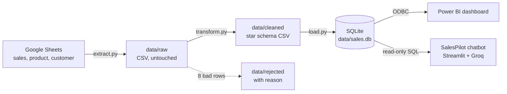

# AKI Sales Performance 2024: Pipeline, Power BI Dashboard and AI Chatbot

Supply Planner case study for AKI Group. A Python pipeline checks and cleans 2024 UAE sales data
from Google Sheets and loads it into a SQLite star schema. A Power BI dashboard and an AI chatbot
(SalesPilot) both read that one database, so they always show the same numbers.

Google Sheets → Extract → Check → Transform → Load (SQLite) → Power BI dashboard + SalesPilot chatbot

## Quick start for reviewers

| What | How | Setup needed |
| --- | --- | --- |
| **Dashboard** | Open `powerbi/sales_dashboard.pbix` in Power BI Desktop | None: the data is already imported in the file |
| **AI chatbot** | https://aki-salespilot.streamlit.app, or **Ask SalesPilot** on any dashboard page | None: runs in the browser |
| **Pipeline** | `python main.py` (see [Run it yourself](#run-it-yourself)) | Python 3.11+ |

In Power BI Desktop, hold **Ctrl** and click a button (such as Ask SalesPilot) to follow it.
The free chatbot host sleeps after a few days without visitors; if you see a "wake up" button,
it takes about a minute to start.

## Architecture

## The data

| Tab | Rows | One row means |
| --- | --- | --- |
| Sales 2024 | 160,572 | one customer bought one product in one month (UAE, AED) |
| Product | 250 | brand, division, category, sub-category |
| Customer | 292 | customer type, sales channel |

This is **sell-in** data: AKI's sales to retailers, not consumer purchases in stores.

## The pipeline

| Step | File | What it does |
| --- | --- | --- |
| Extract | `python/extract.py` | Downloads the 3 tabs into `data/raw` untouched, read as text so nothing is silently converted |
| Profile | `python/profile_data.py` | Measures every column (missing, unique, type, range, links between tables) → `docs/data_profile.md` |
| Deep checks | `python/deep_checks.py` | Answers the questions the profile raised: grain, negatives, sign mismatches, details vs look-ups, labels |
| Transform | `python/transform.py` | Applies the cleaning rules; bad rows go to `data/rejected` with a `reject_reason` |
| Load | `python/load.py`, `sql/schema.sql` | Full refresh into a SQLite star schema in one transaction; verifies row counts |
| Orchestrate | `main.py` | Runs every step, logs each run to `logs/`, then opens the dashboard if every step passed |

**What the checks found:** 0 empty cells, 0 duplicate rows, 0 orphan products or customers, and
month + customer + product is unique. To handle: 9,451 return rows, 216 money-only adjustments,
8 rows where quantity and value have opposite signs, 1,576 rows sold below cost, and inconsistent
customer-type and sales-channel labels.

**Cleaning decisions** (full reasoning in `docs/data_checks.md`):

| Issue | Decision | Why |
| --- | --- | --- |
| A. Returns | Kept and labelled: `transaction_type` = Sale, Return or Adjustment | Deleting them would overstate sales by 5.39M |
| B. Repeated product/customer details in sales | Verified identical to the look-up tabs (0 differences), then kept only the keys | Each fact lives in one place |
| C. Messy labels | Fixed spacing and capitals; split customer type into `trade_type` + `sales_mode` | Look-alike labels are flagged, not merged: that is a business decision |
| D. 8 impossible rows | Moved to `data/rejected/sales_rejected.csv` with a reason | Kept out of the dashboard but available to fix at the source |

**Reconciliation:** 160,572 rows in = 160,564 loaded + 8 rejected. The dashboard total of
AED 441.89M matches the pipeline.

## Data model (star schema)

- `fact_sales`: one row per month, customer and product (160,564 rows)
- `dim_product`: 250 products · `dim_customer`: 292 customers
- `dim_date` (built in Power BI): calendar with UAE public holidays, retail seasons and key events
- Relationships are many-to-one and single-direction
- Helper tables: `_Measures` (all DAX measures) and `Waterfall_Steps` (the waterfall's 4 steps, no relationships)

## Power BI dashboard

File: `powerbi/sales_dashboard.pbix`, themed in AKI colours (`powerbi/aki_theme.json`).
Every page has a KPI row in the same place, the **Ask SalesPilot** button, and Division,
Sales Mode and Trade Type slicers that are **synced across pages**.

| Page | KPI row | Visuals |
| --- | --- | --- |
| Overview | Total Sales, Gross Profit, Gross Margin %, Return Rate %, Active Customers | Monthly sales and gross profit (tooltip: key event, MoM %), monthly table, waterfall from gross sales to gross profit, margin by month vs the 24.41% average |
| Products | Total Sales, Gross Margin %, Return Rate %, Products Sold | Sales by division with drill-down to category and sub-category, top 10 products, brand scatter (sales vs margin) in four groups: Star, Volume driver, Hidden gem, Question mark |
| Customers | Total Sales, Top 10 Customer Share, Sales per Customer, Active Customers | Sales by trade type, return rate by trade type vs the average, sales by sales mode, top 10 customers |

**Key measures (DAX):** Total Sales, Gross Profit, Gross Margin %, Gross Sales, Returns Value,
Return Rate %, MoM Growth %, Top 10 Customer Share %, Customer Rank, Brand Group, Products Sold,
Sales per Customer, Waterfall Value.

## Key insights (2024)

- **AED 441.89M** net sales at a **24.41%** gross margin; returns are **1.21%** of gross sales.
- **Seasonality:** April is the weakest month (26.25M, -24.7% vs March), May rebounds +44%, and
  September peaks at 44.79M. The April drop is in volume, not margin. Hypothesis (sell-in): retailers
  stock up before Ramadan and pause around Eid Al Fitr. Confirming it needs sell-out data or more years.
- **Biggest brands, thin margins:** Brand 16 (91.78M) and Brand 15 (62.75M) are volume drivers at 15-19% margin.
- **Problem products:** P015 sells below cost (-0.61% margin); P105 has an 8.70% return rate, about 7x the average.
- **Divisions:** Automotive sells 21.57M at about 0% margin; Durable Goods earns 39% but has the highest returns (4.84%).
- **Customer concentration:** the top 10 customers are 35.54% of sales; Customer 219 alone bought 29.57M.
  Key Accounts earn only 0.76% margin.
- **Data quality:** 64.11M of sales has no online/offline label, while E-Commerce customers buy 50.43M,
  so the online share is understated.

**Recommendations:** plan stock around the season (less before Eid, early stock for May and September);
protect availability of Brands 16 and 15 while reviewing their pricing; fix price or cost of loss-makers
before re-ordering; check quality where returns are high; agree forecasts and safety stock with the top
10 customers; fix labels and rejected rows at the source.

## SalesPilot AI chatbot

Ask questions in plain English, for example *"Which 5 customers bought the most?"* or
*"Why does product P015 have a negative gross margin?"*

**Live:** https://aki-salespilot.streamlit.app

**How it answers**

1. Rewrites a follow-up question (*"and in May?"*) so it stands on its own.
2. The AI (**GPT-OSS 120B on Groq**) writes a SQL query from the schema and the business rules,
   which use the same formulas as the Power BI measures.
3. Python runs it on a **read-only** connection: `SELECT`/`WITH` only, at most 50 rows, one retry on error.
4. Python formats the numbers (91781371.77 → 91.78M), so the AI never does arithmetic.
5. The AI answers using the result and `docs/business_context.md`. Under every answer,
   *"How I got this answer"* shows the understood question, the SQL and the data.

| Design choice | Why |
| --- | --- |
| Hosted model on Groq (free tier) | Nothing to install for reviewers; fast answers |
| API key in Streamlit Secrets / a gitignored `.streamlit/secrets.toml` | The key never reaches GitHub |
| Read-only database, `SELECT` only | The AI can never change or delete data |
| Python formats the numbers | AI models make mistakes converting large numbers |
| `temperature = 0` | The same question gives the same answer |
| Chats kept per browser session | Visitors never see each other's questions |
| Builds `sales.db` on startup if missing | The hosted app runs the same pipeline, from the same source |

## Run it yourself

**Pipeline**

    python -m venv .venv
    .venv\Scripts\Activate.ps1
    pip install -r requirements.txt
    python main.py

`main.py` runs every step in about 16 seconds, writes a log to `logs/`, and opens the dashboard
when all steps succeed. Use `python main.py --no-dashboard` for scheduled runs.
The Google Sheet must be shared as "Anyone with the link".

**Refreshing the dashboard** (optional; viewing needs none of this): install the 64-bit SQLite3 ODBC
driver (ch-werner), create a User DSN named `SalesDB` pointing at `data/sales.db`, run the pipeline,
then click **Refresh** in Power BI.

**Chatbot locally**

1. Get a free key at [console.groq.com](https://console.groq.com) and save it in `.streamlit/secrets.toml`
   as `GROQ_API_KEY = "gsk_..."` (this file is gitignored).
2. `streamlit run app.py`, then open http://localhost:8501. If `data/sales.db` is missing, the app runs
   the pipeline first.

## Repository layout

| Path | Contents |
| --- | --- |
| `main.py` | Runs the pipeline |
| `python/` | `config.py`, `extract.py`, `profile_data.py`, `deep_checks.py`, `transform.py`, `load.py`, `chatbot.py`, `chatbot_db.py` |
| `sql/schema.sql` | Star schema with keys and checks |
| `powerbi/` | `sales_dashboard.pbix`, `aki_theme.json` |
| `app.py`, `.streamlit/config.toml` | SalesPilot chat page and its theme |
| `docs/` | `data_profile.md`, `data_checks.md`, `business_context.md` |
| `data/`, `logs/` | Created by the pipeline (gitignored) |

## Limits and next steps

- One year of sell-in data shows patterns but can't prove they repeat, or show when consumers buy.
- No stock or lead-time data yet, so no reorder points. Next: add 2-3 more years, sell-out, stock
  and supplier lead times; classify products by importance and demand stability (ABC/XYZ); forecast
  demand and set reorder points per product.
- Production: schedule the pipeline daily, publish the dashboard to Power BI Service with scheduled
  refresh, and run the chatbot on a company-approved AI service with access control.
