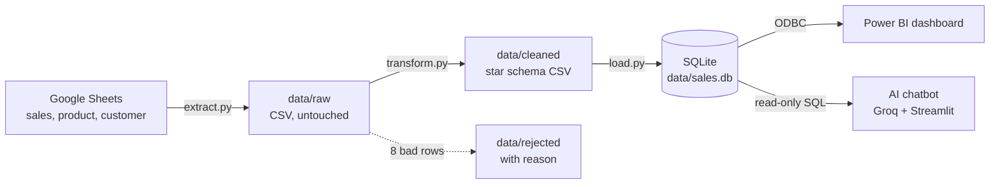

# Sales Data Pipeline → Power BI

An ETL pipeline that takes 2024 sales data from Google Sheets, checks and cleans it,
loads it into a database, and feeds a Power BI dashboard.

Google Sheets → Extract → Transform → Load (SQLite) → Power BI (ODBC)

## Run it

    python -m venv .venv
    .venv\Scripts\Activate.ps1
    pip install -r requirements.txt
    python main.py

Then open `powerbi/sales_dashboard.pbix` and click Refresh.

## Steps

| Step        | File                                          | What it does                                                               |
| ----------- | --------------------------------------------- | -------------------------------------------------------------------------- |
| Extract     | python/extract.py                             | Downloads the sales, product and customer tabs into data/raw, untouched    |
| Profile     | python/profile_data.py, python/deep_checks.py | Measures data quality; findings in docs/data_checks.md                     |
| Transform   | python/transform.py                           | Applies the cleaning decisions; bad rows go to data/rejected with a reason |
| Load        | python/load.py, sql/schema.sql                | Rebuilds a star schema in SQLite and verifies row counts                   |
| Orchestrate | main.py                                       | Runs all steps in order and logs each run to logs/                         |

## Data model (star schema)

- fact_sales: one row per month, customer and product (160,564 rows)
- dim_product: 250 products
- dim_customer: 292 customers

## Results of the latest run

160,572 sales rows extracted, 160,564 loaded, 8 rejected (quantity and value had opposite signs).

## AI chatbot (bonus)

A chat page where anyone can ask questions about the sales data in plain English, for example
*"Which 5 customers bought the most?"* or *"What was the gross margin % in April?"*

**Try it:** https://aki-salespilot.streamlit.app (also opens from the **Ask SalesPilot** button in the dashboard)

**How it works**

1. The question goes to an AI model (**GPT-OSS 120B on Groq**) together with the database schema
   and the business rules (the same formulas as the Power BI measures).
2. The AI writes a SQL query. Python runs it on `data/sales.db`, **the same database Power BI uses**,
   so the chatbot and the dashboard always agree.
3. The result goes back to the AI, which answers in 1-3 sentences. Under every answer,
   *"How I got this answer"* shows the SQL and the data, so every number can be checked.

**Design choices**

| Choice                                              | Why                                                                 |
| --------------------------------------------------- | ------------------------------------------------------------------- |
| Hosted model on Groq (free tier)                    | Nothing to install for reviewers; fast answers                      |
| API key kept in Streamlit secrets, not in the code  | The key never reaches GitHub                                        |
| Read-only database connection, `SELECT` only      | The AI can never change or delete data                              |
| Python formats the numbers, the AI only copies them | AI models make mistakes when converting numbers (e.g. 91.78M)       |
| One automatic retry with the error message          | The AI can fix its own SQL mistakes                                 |
| `temperature = 0`                                 | The same question gives the same answer                             |

**Run it**

1. Get a free API key at [console.groq.com](https://console.groq.com) and save it in
   `.streamlit/secrets.toml` (gitignored) as `GROQ_API_KEY = "gsk_..."`
2. Activate the venv and install the libraries: `pip install -r requirements.txt`
3. Start the chat page: `streamlit run app.py`, then open http://localhost:8501
   (if `data/sales.db` is missing, the app runs the pipeline first)

| File                       | Role                                           |
| -------------------------- | ---------------------------------------------- |
| `app.py`                 | Streamlit chat page                            |
| `python/chatbot.py`      | Question -> SQL -> answer                      |
| `python/chatbot_db.py`   | Describes the tables and runs read-only SQL    |
| `.streamlit/config.toml` | AKI colours, localhost only, no usage tracking |

## Architecture

One pipeline feeds both the dashboard and the chatbot, so they always show the same numbers.

## Power BI dashboard

File: `powerbi/sales_dashboard.pbix`, themed in AKI colours (`powerbi/aki_theme.json`).

| Page | What it shows |
|---|---|
| Overview | KPI cards (sales, gross profit, margin %, return rate %, customers), monthly sales trend with UAE holidays and retail seasons, MoM growth |
| Products | Sales by division, top 10 products, brand scatter (sales vs margin) grouped into Star / Volume driver / Hidden gem / Question mark |
| Customers | Sales by trade type and channel, online vs offline split, return rate by trade type, top 10 customers |

**Key measures (DAX):** Total Sales, Gross Profit, Gross Margin %, Return Rate %, MoM Growth %, Top 10 Customer Share %, Brand Group.

## Key insights (2024)

- **AED 441.89M** net sales at a **24.41%** gross margin; returns are 1.21% of sales.
- **April is the weakest month** (-24.7% vs March) during Ramadan and Eid Al Fitr; sales recover +44% in May and **peak in September**.
- The **two biggest brands** (Brand 16 at 91.78M and Brand 15 at 62.75M) are volume drivers with only 15-19% margin.
- **Product P015 sells below cost** (-0.61% margin), and **P105 has an 8.7% return rate**, about 7x the average.
- **Automotive** sells about 22M at almost 0% margin, while **Durable Goods** earns about 39%.
- **Customer concentration:** the top 10 customers make up 35.5% of sales; Customer 219 alone is 29.57M.
- **Data quality note:** some E-Commerce customers have no Online/Offline label, so the online share is understated.